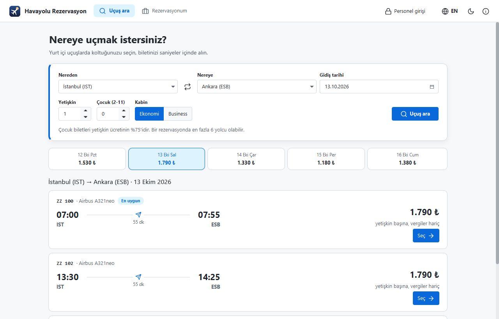
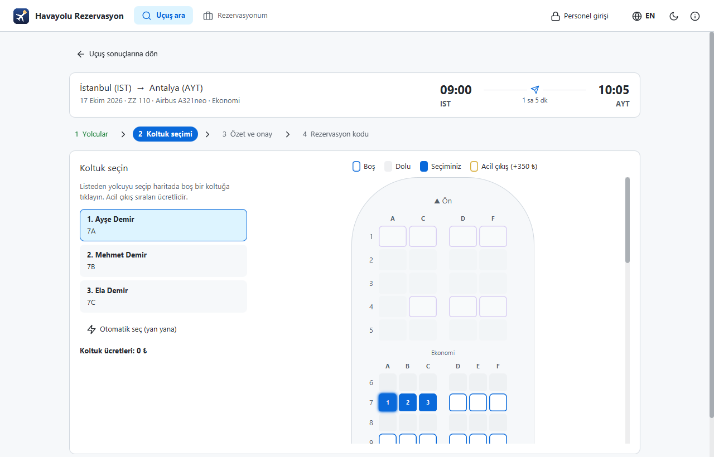
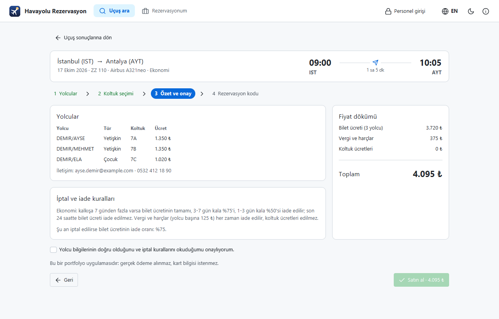
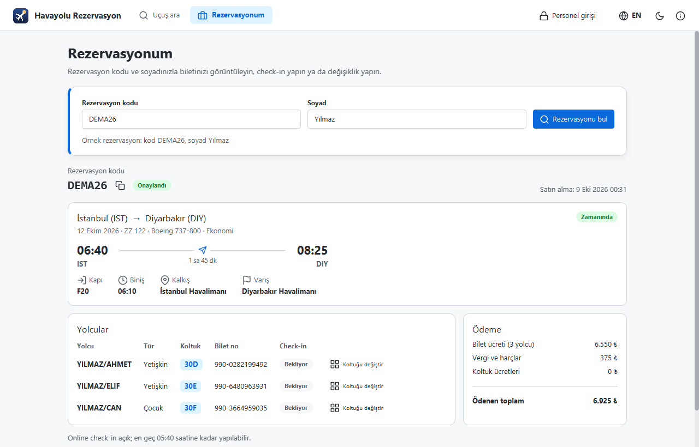
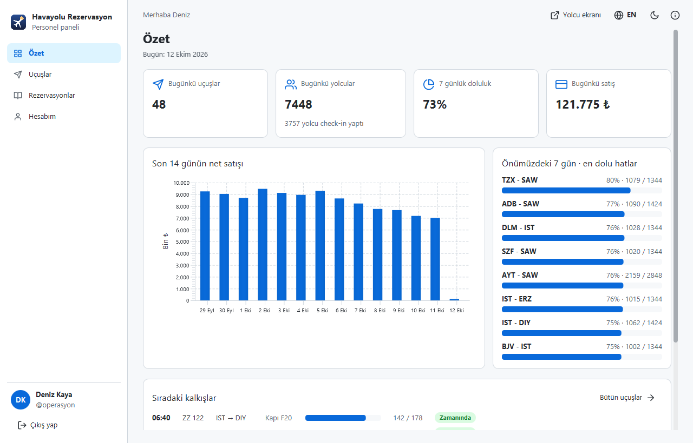
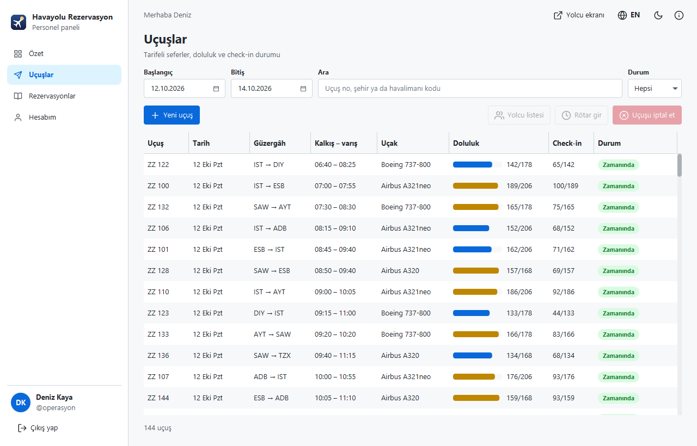
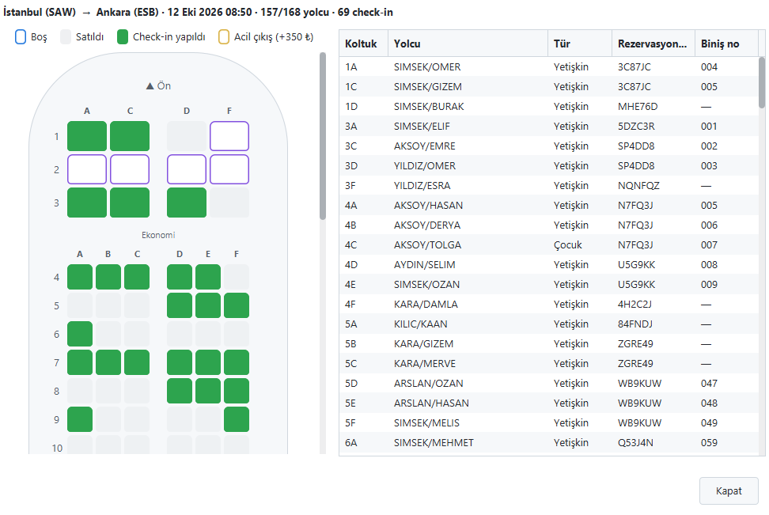
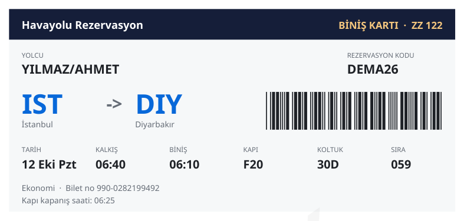
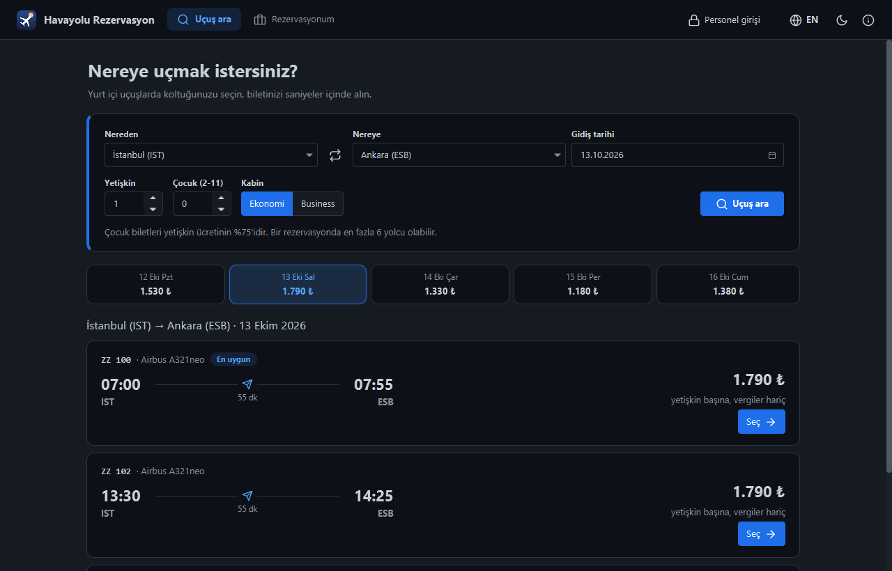

<p align="center">
  
</p>

<h1 align="center">Havayolu Rezervasyon</h1>

<p align="center">
  <a href="README.md">English</a> | <b>Türkçe</b>
</p>

<p align="center">
  Java ve JavaFX ile yazılmış masaüstü uçuş rezervasyon uygulaması: yolcular uçuş arar, koltuğunu<br>
  <b>görsel koltuk haritasından</b> seçer, online check-in yapar ve rezervasyonunu yönetir; personel uçuşları ve yolcu listelerini yönetir.
</p>

<p align="center">
  <a href="https://github.com/MrcDprm/airline-reservation-system/releases/latest"><b>⬇️ Windows için indir</b></a>
</p>

<p align="center">
  
</p>

> Bu bir portfolyo projesidir, gerçek bir havayolu değildir. Uygulama yereldir: aynı bilgisayardaki tek bir SQLite veritabanıyla çalışır, sunucu yoktur. Havayolu (`ZZ` uçuş numaraları), uçuşlar ve ücretler hayalidir, ödeme alınmaz ve üretilen her PDF örnek olarak işaretlidir.

## Özellikler

**Yolcu tarafı**
- Kalkış, varış, tarih, yetişkin ve çocuk sayısı ve kabine (Ekonomi / Business) göre **uçuş arama**
- Seçilen tarihin 3 gün öncesi ve sonrasının en düşük fiyatlarını gösteren **tarih şeridi**
- **Dinamik fiyat:** uçak doldukça (4 doluluk kademesi) ve son 72 saatte bilet pahalanır; çocuklar %75 öder
- Üç uçak tipi (A320, 737-800, A321neo) için **görsel koltuk haritası**: 2-2 business ve 3-3 ekonomi düzeni, dolu koltuklar, ücretli geniş bacak mesafeli acil çıkış sıraları ve gruplar için "yan yana otomatik seç"
- Dört adımda satın alma: yolcular → koltuklar → fiyat dökümü ve iade kurallarıyla özet → **rezervasyon kodu (PNR)**
- Uçuş, yolcular, bilet numaraları ve ödemeyle **PDF e-bilet**
- Rezervasyon kodu + soyadla **Rezervasyonum**: koltuk değiştirme, **online check-in** (kalkıştan 24 saat önce açılır, 60 dakika önce kapanır), kapı, biniş saati, sıra numarası ve Code 39 barkodlu **PDF biniş kartı**
- Onaydan önce gösterilen **iade kuralıyla iptal**: bilet ücretinin iadesi kabine ve kalan süreye bağlıdır, vergiler her zaman iade edilir, koltuk ücretleri edilmez

**Personel paneli**
- **Argon2id** şifre özetiyle giriş, 5 hatalı denemede kilit; 10 dakika işlem yapılmazsa otomatik çıkış
- **Özet:** bugünkü uçuşlar ve yolcular, check-in sayısı, 7 günlük doluluk, son 14 günün net satışı (grafik), en dolu hatlar ve sıradaki kalkışlar
- **Uçuşlar:** tarih aralığı, arama ve durum filtresi, doluluk ve check-in sütunları
- Mesafeye göre ücret ve süre önerisiyle **yeni uçuş**; aynı uçuş numarasıyla 60 güne kadar her gün tekrarlanır
- **Rötar** (kalkış ve varış birlikte kayar) ve **uçuş iptali** (bütün rezervasyonlara tam iade)
- Check-in yapılan koltukların ayrı renkte göründüğü doluluk haritasıyla **yolcu listesi**
- **Rezervasyonlar:** kod, ad ya da e-postayla arama; ayrıntı, e-bilet ve iptal

**Doğruluk ve güvenlik**
- Fiyat her zaman servis katmanında hesaplanır; yolcu özet ekranındayken fiyat değişirse rezervasyon durdurulur ve yeni toplam gösterilir
- Kısmi benzersiz indeks (`UNIQUE (flight_id, seat) WHERE active = 1`) aynı koltuğun iki kez satılmasını, iki rezervasyon aynı anda yapılsa bile imkânsız kılar
- Her rezervasyon tek bir veritabanı işleminde kaydedilir: biletsiz rezervasyon kalmaz
- Rezervasyon kodları ve bilet numaraları sıralı değil rastgeledir (`SecureRandom`); kodlarda birbirine benzeyen karakterler (0/O, 1/I/L) yoktur
- Rezervasyon aramasında kod da soyad da yanlışsa aynı mesaj verilir; 5 hatalı denemeden sonra kısa süre beklenir
- Bütün SQL sorguları parametrelidir; arama metni `LIKE` için kaçışlanır
- Tutarlar kuruş cinsinden tam sayı olarak tutulur, asla ondalıklı sayı olarak değil
- Beklenmeyen hatalarda kısa bir mesaj gösterilir, asla stack trace değil

**Masaüstü uygulaması**
- Türkçe ve İngilizce, açık ve koyu tema (AtlantaFX)
- İlk açılışta personel hesabı oluşturulur; örnek veri (19 hat, 4 haftalık tarife, yaklaşık 130.000 bilet, rötarlar ve iptaller) tek tıkla yüklenebilir
- Veriler kullanıcı klasöründe (`%APPDATA%\MrcDprm\AirlineReservations`) tutulur, program klasörüne yazılmaz
- Windows kurulum dosyası, ikon, sürüm ve Hakkında penceresi

## Ekran Görüntüleri

| Koltuk seçimi | Özet ve fiyat dökümü |
|:---:|:---:|
|  |  |
| **Rezervasyonum** | **Personel özeti** |
|  |  |
| **Uçuşlar** | **Yolcu listesi** |
|  |  |
| **Biniş kartı (PDF)** | **Koyu tema** |
|  |  |

## Kurulum

1. [Releases](https://github.com/MrcDprm/airline-reservation-system/releases/latest) sayfasından `AirlineReservations-1.0.0-Setup.exe` dosyasını indirip çalıştırın. Java kurmanız gerekmez, uygulamayla birlikte gelir.
2. İlk açılışta personel hesabını oluşturun. Uygulamayı hemen denemek için **Örnek veri yükle** seçili kalsın.
3. Örnek veri yüklüyse şunları deneyebilirsiniz:

| Ne | Nasıl |
|---|---|
| Örnek rezervasyon (check-in açık) | **Rezervasyonum** → kod `DEMA26`, soyad `Yılmaz` |
| Personel paneli | **Personel girişi** → `operasyon` / `Ucus.Demo2026` (ya da oluşturduğunuz hesap) |

Örnek tarife kurulum gününden bir hafta önce başlar, üç hafta sonra biter; örnek rezervasyonun uçuşu kurulumdan sonraki bir gün içinde kalkar. Personel panelinden istediğiniz zaman yeni uçuş eklenebilir.

Verileriniz `%APPDATA%\MrcDprm\AirlineReservations` klasöründe kalır. Windows "Uygulamalar" ayarlarından kaldırabilirsiniz; veri klasörü silinmez, isterseniz elle silebilirsiniz.

## Kullanılan Teknolojiler

- **Java**, **Maven**
- **JavaFX**: kullanıcı arayüzü ve grafikler
- **AtlantaFX** (tema), **Ikonli + Feather** (simgeler)
- **SQLite** (sqlite-jdbc): yerel veritabanı
- **Bouncy Castle**: Argon2id şifre özeti
- **Apache PDFBox** + **Noto Sans**: Türkçe karakterli e-bilet ve biniş kartı
- **JUnit**: testler
- **jpackage** + **Inno Setup**: Windows kurulum dosyası

## Proje Yapısı

```
src/main/java/com/mrcdprm/airline/
├── core/      Havalimanları, uçak koltuk düzenleri, fiyat, iade kuralları, kodlar, adlar, doğrulama, şifreler
├── data/      SQLite bağlantısı, şema, işlemler ve satır kayıtları
├── service/   Giriş, uçuş arama ve yönetimi, rezervasyonlar, check-in, raporlar, örnek veri
├── pdf/       E-bilet ve biniş kartı PDF'leri (Code 39 barkodlu)
├── ui/        Yolcu ekranları, satın alma adımları, koltuk haritası, personel paneli, diyaloglar, tema, çeviriler
├── AirlineApp.java
└── Launcher.java
src/main/resources/   Stiller, ikon, yazı tipleri, Türkçe ve İngilizce metinler
src/test/java/        JUnit testleri
installer/            Derleme betiği, Inno Setup betiği ve ikon
```

## Kaynaktan Derleme

JDK (sürümü `pom.xml` dosyasında) ve Maven gerekir.

```
mvn test          # 33 test
mvn javafx:run    # uygulamayı çalıştır
```

### Kurulum dosyasını oluşturma

[Inno Setup](https://jrsoftware.org/isinfo.php) gerekir.

```
powershell -ExecutionPolicy Bypass -File installer\build.ps1
ISCC installer\AirlineReservations.iss
```

`build.ps1` testleri çalıştırır, uygulamanın ihtiyaç duyduğu JDK modüllerini `jdeps` ile bulur ve `jpackage` ile küçültülmüş bir Java çalışma ortamıyla (sadece Türkçe ve İngilizce yerel ayar verisi) `dist\AirlineReservations` klasörünü oluşturur. Kurulum dosyası `installer\Output\` içinde oluşur.

**Yeni sürüm çıkarırken:** `pom.xml`, `AirlineApp.VERSION`, `installer/build.ps1` ve `installer/AirlineReservations.iss` içindeki sürümü güncelleyin, iki komutu çalıştırın ve kurulum dosyasını yeni bir GitHub Release'e yükleyin.

## Öğrendiklerim

- **Kuralı veritabanına da korutmak.** "Koltuk boş mu?" diye Java'da bakıp sonra kaydetmek, iki rezervasyonun aynı koltuğu alabileceği bir boşluk bırakıyor. Sadece geçerli biletler için `(flight_id, seat)` üzerinde kısmi benzersiz indeks ekledim; iptal edilen bilet koltuğu boşaltıyor ama iki geçerli bilet asla aynı koltukta olamıyor. Bir test 16 iş parçacığıyla aynı anda 17C koltuğunu almaya çalışıyor ve sadece birinin başarmasını bekliyor.
- **Ekrandaki fiyata güvenmemek.** Özet ekranı bir teklif gösteriyor, ama rezervasyon servisi fiyatı aynı işlemin içinde yeniden hesaplıyor ve değiştiyse rezervasyonu reddediyor. Test saatini son 72 saate almak "fiyat değişti" yolunu görmek için yetiyor.
- **Koltuk haritasını modellemek.** Her uçak tipi koltuklarını birkaç sayıdan (business sıra sayısı, son sıra, acil çıkış sıraları) üretiyor. Görsel harita, koltuk doğrulaması, geniş bacak mesafesi ücreti ve "yan yana koltuk" araması aynı listeyi kullanıyor; böylece arayüz ile kurallar birbirinden ayrışamıyor.
- **Zamana bağlı iş kuralları.** Satış ve check-in pencereleri, son dakika zammı ve iade oranları "şimdi"ye bağlı; bu yüzden servisler `Clock` alıyor. Testler saati kalkıştan 23 saat, 59 dakika ya da 5 gün önceye alıp her kuralı deniyor.
- **Hesapsız erişim.** Yolcunun girişi yok; havayolu sitelerindeki gibi rezervasyon kodu + soyad anahtar görevi görüyor. Kod rastgele, hata mesajı hangisinin yanlış olduğunu söylemiyor, tekrarlanan hatalı denemeler yavaşlatılıyor ve soyad karşılaştırması Türkçe harfleri sadeleştirdiği için `yilmaz`, `Yılmaz` ve `YILMAZ` eşleşiyor.
- **Gerçekçi örnek veriyi hızlı üretmek.** Yaklaşık 130.000 bilet tek işlemde, toplu (batch) hazır ifadelerle yazılıyor. Koltuklar karıştırılmış sıra düzeninde sıra sıra dolduruluyor, böylece gruplar çoğunlukla yan yana oturuyor; ücretler uygulamanın kullandığı fiyat koduyla hesaplanıyor.
- **Belge çizmek.** E-bileti ve biniş kartlarını PDFBox ile çizdim; Code 39 barkodunu kendim yazdım (her karakter 5 çubuk ve 4 boşluk, bunların 3'ü geniş).
- **Windows Forms'a kıyasla JavaFX.** Mutlak konumlar yerine yerleşim panelleri, özellik pencereleri yerine CSS, yavaş işleri arayüz iş parçacığından uzak tutmak için `Task`, ilerleme çubukları ve durum rozetleri için özel hücreli `TableView`.

## Gelecek Planları

- Gidiş-dönüş ve çok duraklı arama
- Bagaj ve yemek ekleri
- Online ödeme simülasyonu
- Yolcular için uçuş durumu sayfası
- Rötar ve iptallerde e-posta bildirimi
- Merkezî veritabanlı istemci-sunucu sürümü

## Lisans

[MIT](LICENSE) © 2026 Miraç Deprem
